<p align="center">
  
</p>

<h1 align="center">FIOracle</h1>

<p align="center">
  <strong>Regime-Aware Fixed Income Oracle</strong>
</p>

<br/>

<p align="center">
  <a href="#what-it-is">What it is</a> •
  <a href="#meridian">Meridian</a> •
  <a href="#forecast">Forecast</a> •
  <a href="#regimes">Regimes</a> •
  <a href="#results">Results</a> •
  <a href="#usage">Usage</a>
</p>

---

<h2 id="what-it-is">What it is</h2>

FIOracle fits a jump model that names three states on a fixed-income book: calm, inflationary, and crisis. An XGBoost classifier then forecasts the next state from today's returns and macros. The long-only weights that follow are minimum variance, mean variance, and equal weight.

**Research software. Not investment advice. Backtests are hypothetical performance.**
See `paper/compliance/HYPOTHETICAL_PERFORMANCE.md`. Do not post ERoD/Sharpe tables as mass-market performance.

<h2 id="meridian">Meridian</h2>

Meridian reads 23 public books on a date you choose. It keeps the latest row dated on or before that date. Heat runs from 0 to 100. Under 40 the book is Quiet, from 40 it is Warming, and from 70 it is Stretched. Cash stays at 0.

The reading is published at [zauberstern.github.io/fioracle/compass](https://zauberstern.github.io/fioracle/compass/). Stillmoor is the same history played as a desk, at [zauberstern.github.io/fioracle/compass/desk](https://zauberstern.github.io/fioracle/compass/desk/).

These figures describe the public marks for the date you pin. They are not a forecast or a recommendation.

<h2 id="forecast">How a forecast is made</h2>

The jump model and the XGBoost classifier are in [`src/core/regimes.py`](src/core/regimes.py). `rolling_regime_forecasting` in that file refits on a walk-forward window. The point-in-time store is [`src/core/store.py`](src/core/store.py): a macro row is visible on `available_date`, and the store does not lag it a second time. Weights are [`src/core/portfolio.py`](src/core/portfolio.py) for `minvar`, `mv`, and `ew`.

The published split is train 1965–1994, validation 1995–2007, and test from 2008-01-01 through 2025-11-28. Macros enter on their publication lag. On the store path that lag is `available_date`, applied once. The jump model rolls a 10-year train, a 2-year validation, and a 6-month update. Features are trailing windows.

### Asset universe (paper freeze)

**18 investable** series (see `config/config.yaml` / `paper/PAPER_EXPERIMENT.md`): cash, US Treasuries (cash through long), US and global aggregate and credit, EM USD aggregate, TIPS and the 5-year inflation swap, global inflation-linked bonds 0–5, Swiss franc, the USD swaption 1Y5Y, and Swiss government 7–15.

23 other series load for research context and stay out of the optimizer.

### Macros enabled on that freeze

VIX, geopolitical risk, US inflation, US high-yield OAS, and US unemployment. Debt-to-GDP, economic policy uncertainty, GDP growth, and M2 velocity are off at load.

<h2 id="regimes">Regime pictures</h2>

Each chart is one book from the 31 Jul 2026 run. The top band is the jump model. The bottom band is the XGBoost forecast. Calm, inflationary, and crisis are in the legend.

Swiss franc.

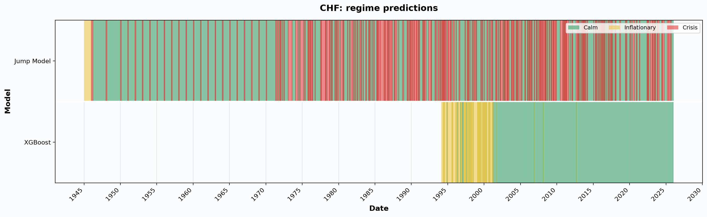

US aggregate bond.

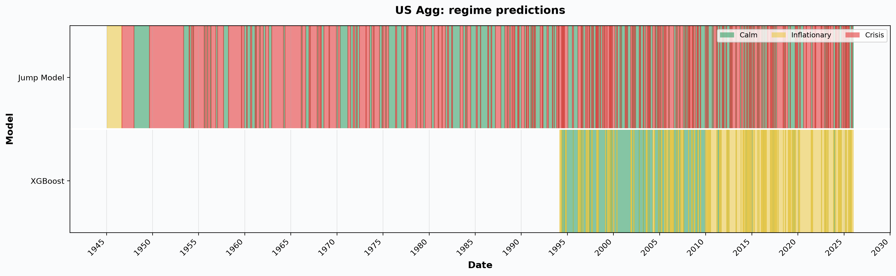

US 10-year Treasury.

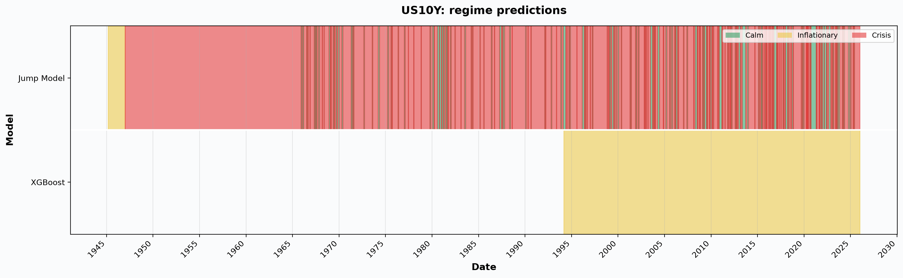

1–3 year Treasury.

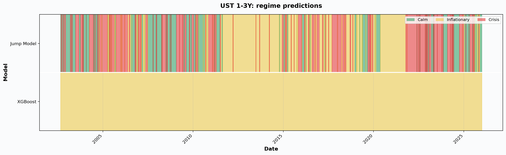

7–10 year Treasury.

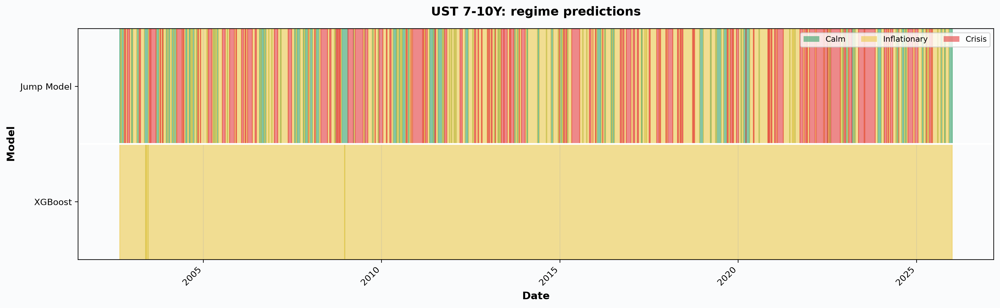

20-year and longer Treasury.

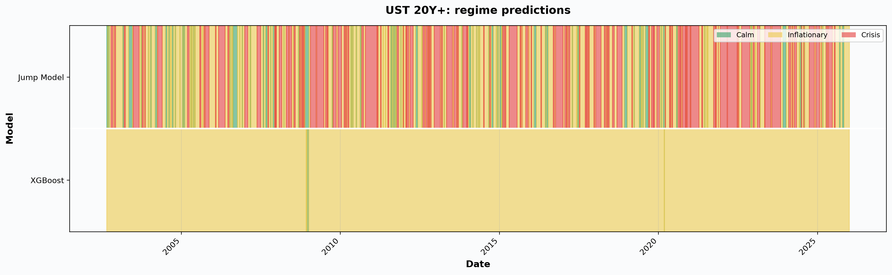

US inflation-linked, 0–5 years. This series is a total return.

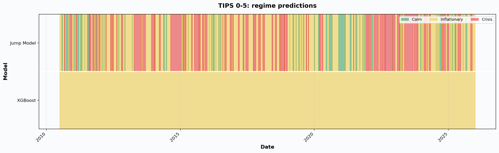

US high yield.

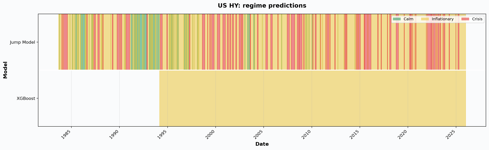

Gold. This series is a total return.

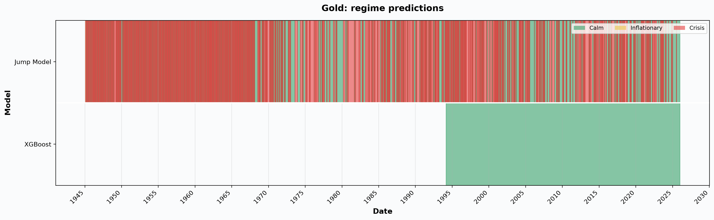

### Feature importance

The bars are the average importance across assets on the test split, taken from `output/max_cap/diagnostics/test/xgb_diagnostics.json`. The axis names are labels. The bar lengths are the saved numbers. The tallest bar is the 21-day change in unemployment. The next is the 21-day change in inflation.

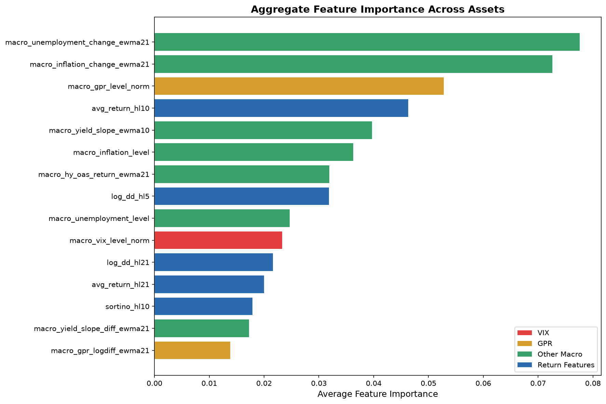

<h2 id="results">Results</h2>

### Out-of-sample test window

These rows are the 31 Jul 2026 store run on `fioracle_ds_v2`, 4,506 test days. Source: `paper/tables/headline_oos.csv`. Total return is the change over that window, not an annual rate. The FI allocation SPA versus Agg / 60-40 is a null, and the gate is `cleared: false`.

| Metric | MinVar | MVO | EW |
|--------|--------|-----|-----|
| **Sharpe ratio** | 0.37 | 0.48 | 0.74 |
| **Total return** | 15.0% | 56.5% | 93.3% |
| **Max drawdown** | −4.8% | −11.2% | −15.3% |

### Crisis windows

Source: `paper/tables/crisis_subperiods.csv`. GFC (2008-09-01 to 2009-03-31) and Euro (2011-07-01 to 2012-06-30) have 0 days in that file, so they are omitted.

| Window | Days | Strategy | Sharpe | Total return | Max drawdown |
|--------|------|----------|--------|--------------|--------------|
| COVID, 15 Feb 2020 to 30 Apr 2020 | 43 | MinVar | −0.91 | −1.5% | −3.2% |
| COVID, 15 Feb 2020 to 30 Apr 2020 | 43 | MVO | −1.57 | −10.8% | −18.5% |
| COVID, 15 Feb 2020 to 30 Apr 2020 | 43 | EW | −0.02 | −0.4% | −5.4% |
| 2022 rates, 1 Jan 2022 to 31 Dec 2022 | 209 | MinVar | 1.14 | 3.0% | −1.8% |
| 2022 rates, 1 Jan 2022 to 31 Dec 2022 | 209 | MVO | 1.70 | 10.2% | −3.0% |
| 2022 rates, 1 Jan 2022 to 31 Dec 2022 | 209 | EW | 0.66 | 2.2% | −3.0% |

### Forecast quality, test split

Source: `paper/tables/forecast_quality.csv`, rows whose path contains `diagnostics/test/`. A blank Brier cell is blank in the file.

| Asset | Brier | Accuracy | Balanced accuracy |
|-------|-------|----------|-------------------|
| US cash |  | 0.999 | 0.500 |
| US 10-year | 0.263 | 0.646 | 0.476 |
| US Treasury | 0.536 | 0.196 | 0.333 |
| US aggregate | 0.666 | 0.001 | 0.333 |
| US corporate | 0.145 | 0.890 | 0.624 |
| US high yield | 0.197 | 0.766 | 0.876 |
| Gold | 0.263 | 0.649 | 0.503 |

### Probability of backtest overfitting

Source: `paper/tables/pbo.csv`. PBO is 0.0 on 15 paths across 3 strategies. The file marks that path count as under-powered and says not to cite it as proof of no overfitting.

### Cumulative wealth, test window

Equal weight.

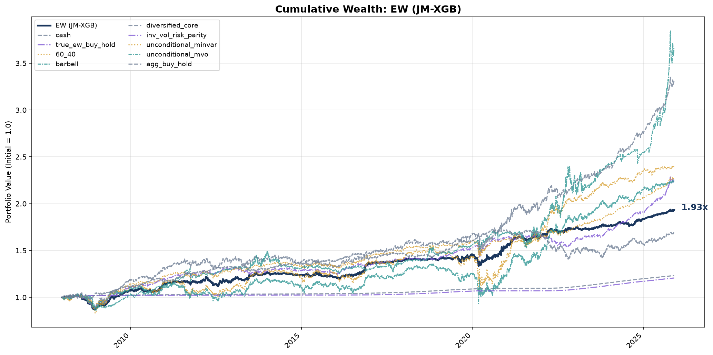

Minimum variance.

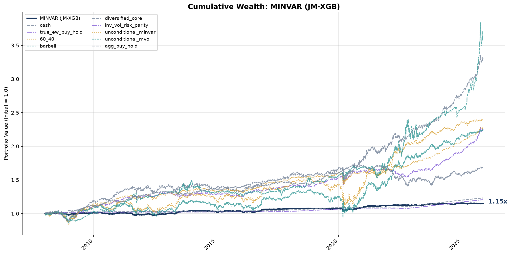

Mean variance.

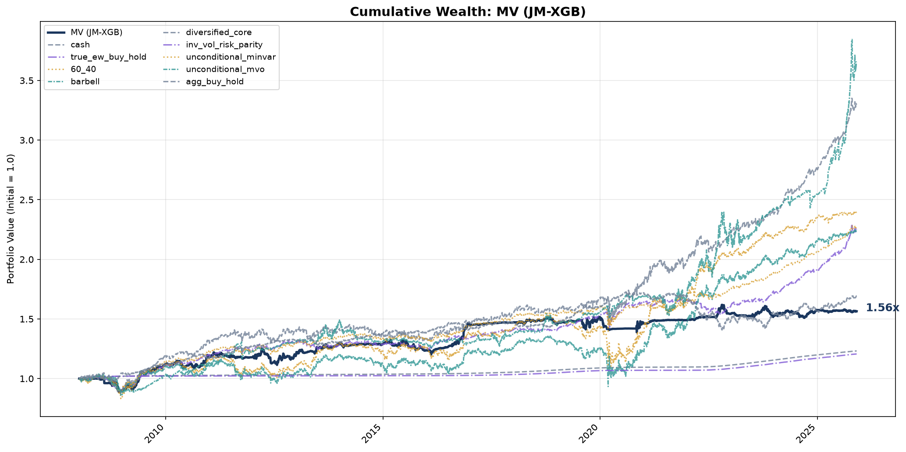

### Drawdown, test window

Equal weight.

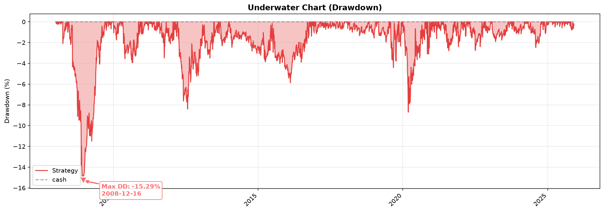

Minimum variance.

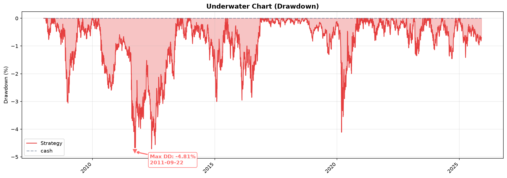

Mean variance.

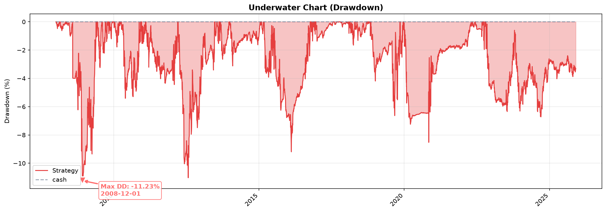

### Allocation over the test window

Equal weight.

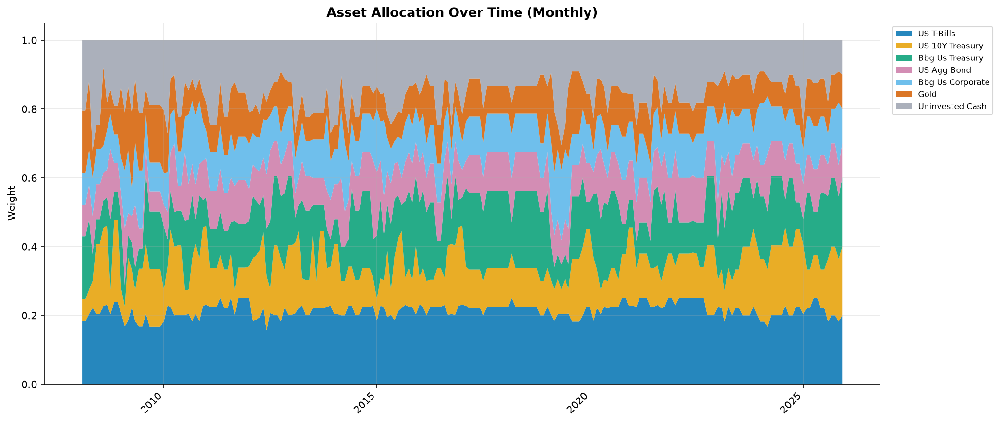

Minimum variance.

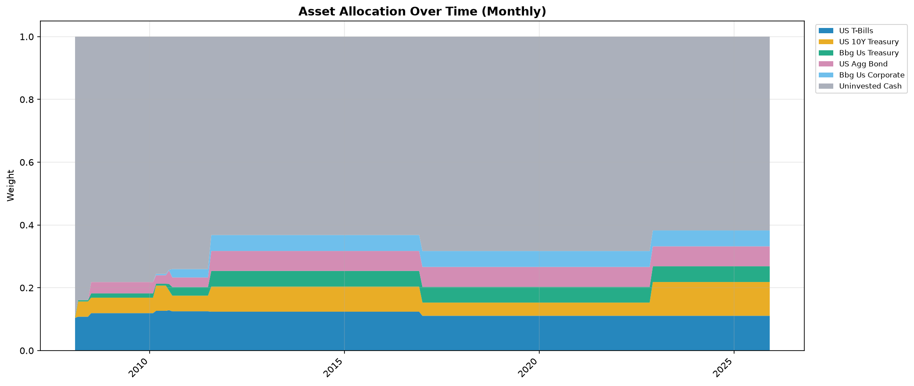

### Rolling Sharpe, test window

Equal weight.

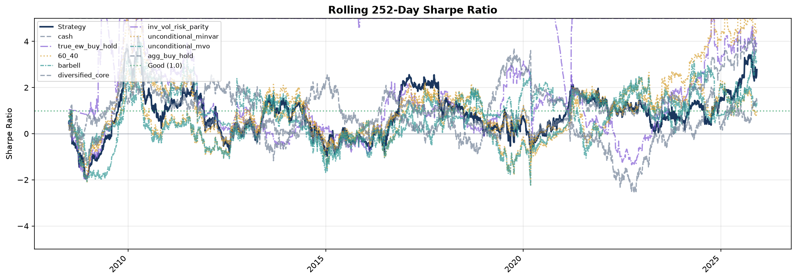

Minimum variance.

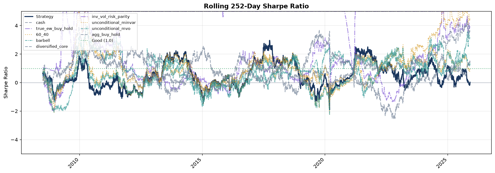

Mean variance.

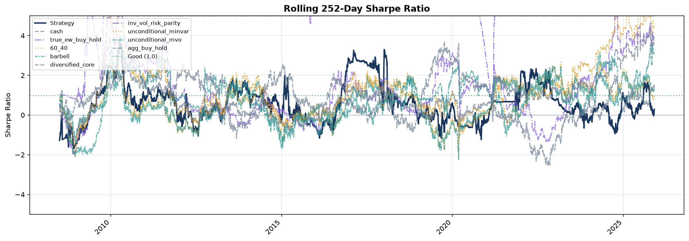

---

<h2 id="usage">Usage</h2>

GitHub Pages serves the folder `/docs` on `main`. The gate on that site is `cleared: false`. Replace `contactEmail` in `docs/site-config.js` before treating the briefing link as a real inbox. Formspree stays `PLACEHOLDER` until a form id is set. Analytics default off.

### Installation

```bash
# Clone repository
git clone https://github.com/zauberstern/fioracle.git
cd fioracle

# Create virtual environment
python -m venv .venv
source .venv/bin/activate  # Linux/Mac
# .venv\Scripts\activate  # Windows

# Install dependencies
pip install -r requirements.txt
```

### Quick start

```bash
# Run full pipeline (quick mode for testing)
python main.py --quick

# Run full pipeline (all data, 1945-present)
python main.py
```

### Adding a series

1. Place a CSV in `asset_universe/` with columns `Date` and `Value` (or a close column the loader already accepts).
2. Add the filename without `.csv` to `assets.investable` in `config/config.yaml`.
3. Run the pipeline. It detects the column layout from the file.

### Output layout

```
output/
├── figures/
│   ├── test/
│   │   ├── mv/
│   │   ├── minvar/
│   │   ├── ew/
│   │   └── xgb_diagnostics/
│   └── historical/
├── results/
│   ├── pipeline_summary.json
│   └── test/
└── models/
```

### Config keys (paper freeze)

All settings live in `config/config.yaml`. Trust that file over this page if a number disagrees.

| Section | What it controls |
|---------|------------------|
| `data` | Train, validation, and test dates, and the store dataset |
| `assets` | Investable series and categories |
| `macro` | Which macros load |
| `macro_lags` | Publication delays |
| `regimes` | Jump-model lambda, XGBoost depth, state count |
| `portfolio` | Risk aversion, max weight, costs |

```yaml
data:
  train_start: 1965-01-01
  train_end: 1994-12-31
  val_end: 2007-12-31
  test_start: 2008-01-01
  backend: store
  dataset_id: fioracle_ds_v2

regimes:
  jump_model:
    n_states: 3
    default_lambda: 2.0
  xgboost:
    max_depth: 3
    subsample: 0.7

portfolio:
  gamma_risk: 8.0
  max_weight: 0.20
  transaction_cost: 0.0005   # 5 bps flat; tiered off for main paper
  robustness_grid:
    enabled: false
```

| Goal | Change |
|------|--------|
| Conservative | `gamma_risk: 12`, `max_weight: 0.15` |
| Aggressive | `gamma_risk: 5`, `max_weight: 0.25` |
| Fast local run | `python main.py --quick` |

The FI convexity overlay keeps `features.dii.enabled: false` and `vrp_overlay.enabled: false`.

### Limitations

- A crisis label can print one to three days after the drawdown has started.
- The book is long-only. Defense is a rotation into cash and the investable havens.
- The book is in USD. FX hedging is not in the optimizer.
- Costs are a flat 5 basis points. Quoted spreads differ by instrument.

### Citation

```bibtex
@software{fioracle2025,
  title={FIOracle: Regime-Aware Fixed Income Portfolio Optimization},
  author={Yadav, Kartik},
  year={2025},
  url={https://github.com/zauberstern/fioracle}
}
```

Shu, Yu, and Mulvey (2024) is the method source: *Dynamic Asset Allocation with Asset-Specific Regime Forecasts*, Annals of Operations Research, [DOI 10.1007/s10479-024-06266-0](https://doi.org/10.1007/s10479-024-06266-0), [arXiv:2406.09578](https://arxiv.org/abs/2406.09578). The local copy is [`paper.pdf`](paper.pdf). See `paper/refs/shu_yu_mulvey_2024.bib`.

### License

This project is licensed under the MIT License. See the [LICENSE](LICENSE) file.
