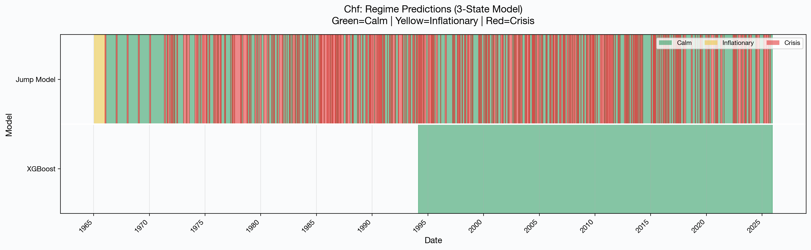
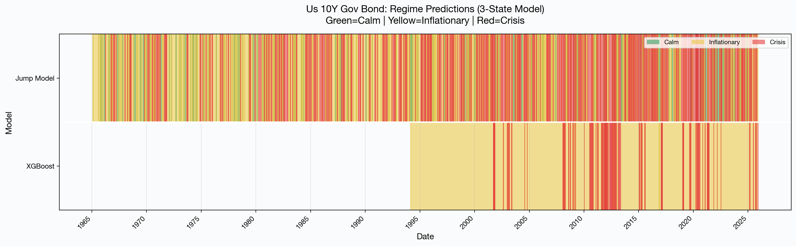
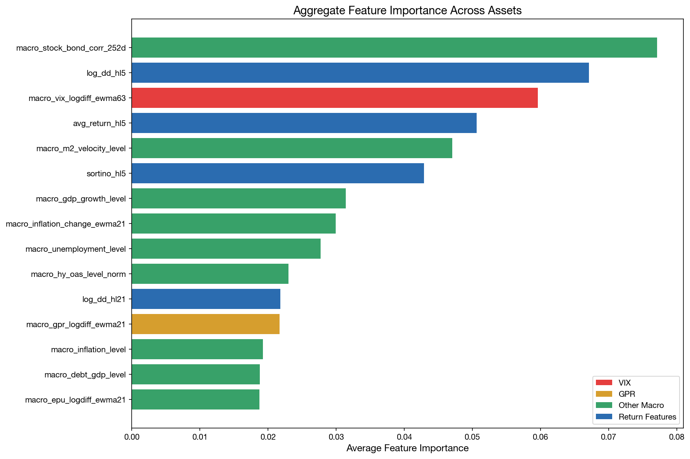
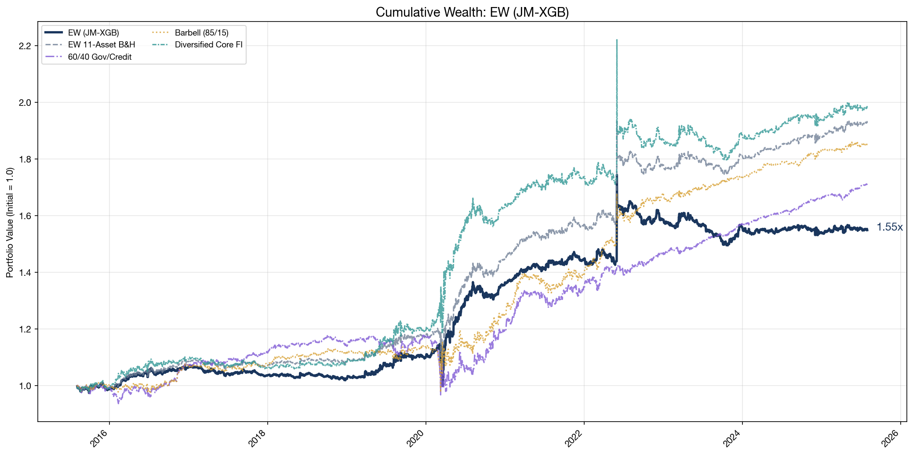
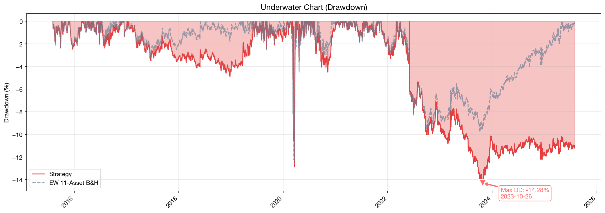
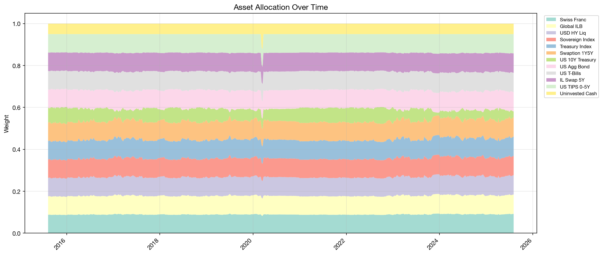
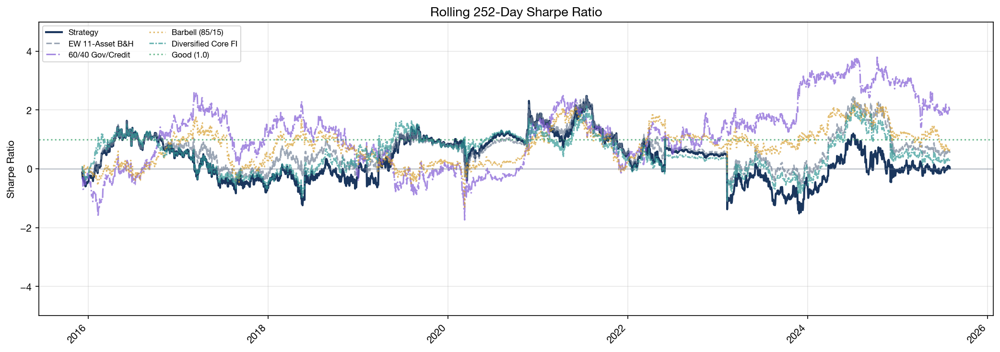
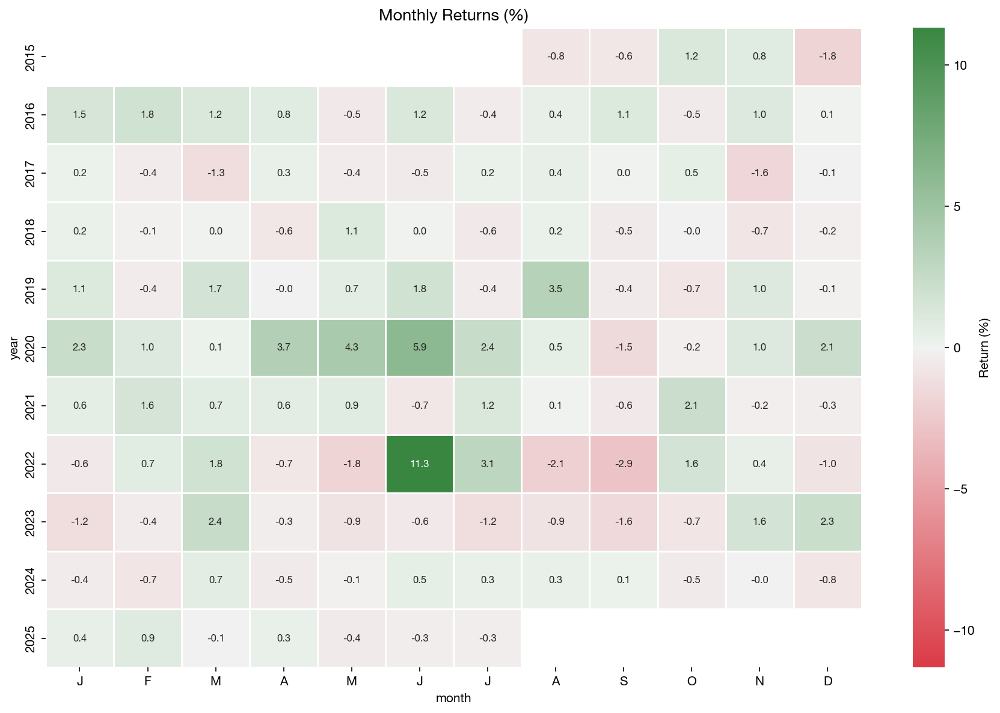

<p align="center">
  
</p>

<h1 align="center">FIOracle</h1>

<p align="center">
  <strong>Regime-Aware Fixed Income Oracle</strong>
</p>

<br/>

<p align="center">
  <em>A machine learning framework for dynamic fixed income portfolio allocation that identifies market regimes and adapts positioning to navigate calm, inflationary, and crisis environments.</em>
</p>

<p align="center">
  <a href="#architecture">Architecture</a> •
  <a href="#results">Results</a> •
  <a href="#usage">Usage</a> •
  <a href="#config-manual">Config Manual</a> •
  <a href="#limitations">Limitations</a>
</p>

---

## Meridian

Meridian reads 23 public books on a date you choose. It keeps the latest row dated on or before that date. Heat runs from 0 to 100. Under 40 the book is Quiet. From 40 it is Warming. From 70 it is Stretched. Cash stays at 0.

On this history the number is the distance above the path the book had been following, plus a fast-rise check. The path adds 12 points per step and stops at 40. The fast-rise check is the Phillips, Shi and Yu (2015) screen. When the check is on, it starts at 25 and adds 8 points for each unit past 1.49. When the check is off, it is 5 points times the reading. A break date can add up to 30 points, and news tone can add up to 15. Both are missing here, so each adds 0. The sum stops at 100.

The published history has 234 rows, from 1 Jan 2008 through 2 Oct 2026. Five dates are marked.

On 1 Jan 2008, Stocks is Quiet at 2.3. On 22 Aug 2008, the row the Lehman week lands on, Stocks is Quiet at 4.4. The same row puts the US inflation-linked book at 100, because its fast-rise reading is far above 1.49 and the score stops at 100. That book is a total return. Consumer prices are not in this history. The other marked rows are 26 Feb 2020, 3 Jan 2022, and 17 Feb 2023. Open them on the page and read the books as of that row.

The reading is published at [zauberstern.github.io/fioracle/compass](https://zauberstern.github.io/fioracle/compass/). Stillmoor is the same history played as a desk, at [zauberstern.github.io/fioracle/compass/desk](https://zauberstern.github.io/fioracle/compass/desk/).

The pages are static files under `docs/compass/`. They do not use Supabase. If you add a database later, put the project URL and the anon key in a gitignored `.env` as `VITE_SUPABASE_URL` and `VITE_SUPABASE_ANON_KEY`, and store the same names as GitHub Actions secrets. Do not give the service role key a `VITE_` name, and do not commit it.

These figures describe the public marks for the date you pin. They are not a forecast or a recommendation.

## Disclaimer

**Research software. Not investment advice. Backtests are hypothetical performance.**
See `paper/compliance/HYPOTHETICAL_PERFORMANCE.md`. Do not post ERoD/Sharpe tables as mass-market performance.

## Public site

GitHub Pages (folder `/docs` on `main`): research documentation and manifesto.
Not a performance advertisement. Gate status on the site is `cleared: false`.

Renewable-gas research cockpit: [`docs/molecule/`](docs/molecule/) (Track G) — pinned GSAP acts, Three.js tubes/particles/shaders, orb guide, mute-default Howler, Simple Mode.
Timeline JSON is fail-closed (`certificates: unpriced`, `cleared: false` until gates pass).

Replace `contactEmail` in `docs/site-config.js` before treating the briefing CTA as real.
Formspree stays `PLACEHOLDER` until a real form id is configured. Analytics default off.

## Renewable gas engine (research)

Dual-track extension on the same PIT lake / SPA culture — **not** a rewrite of the FI spine.

| Piece | Path |
|---|---|
| Paper lock (DII/IG) | `authority_corpus/papers/LOCK.json`, `src/core/dii.py`, `src/core/dii_causal.py` |
| Energy dataset | `config/config.energy_v1.yaml` → `fioracle_energy_v1` |
| Promote TTF/EUA | `scripts/promote_energy_drop_to_landing.py` |
| AGSI / ALSI / NAO | `scripts/fetch_agsi_storage.py`, `scripts/fetch_gie_physical.py`, `scripts/fetch_nao.py` |
| Engine WF | `scripts/run_rg_engine.py` |
| Storage RL (PPO/SAC/DQN) | `scripts/train_storage_agents.py` |
| Timeline → Pages | `scripts/export_rg_timeline.py` → `docs/molecule/` |
| Experiment class | `fioracle_rg_engine_v1` (SPA vs baseline panel; certificates unpriced) |

```bash
# Promote energy parquet → landings + ingest (separate from fioracle_ds_v3)
.venv/bin/python scripts/promote_energy_drop_to_landing.py
# Live AGSI/ALSI (needs GIE_AGSI_API_KEY in .env); use --fixture-fallback only for CI/offline
.venv/bin/python scripts/fetch_agsi_storage.py --start 2011-01-01
.venv/bin/python scripts/fetch_gie_physical.py --start 2012-01-01
.venv/bin/python scripts/fetch_nao.py
.venv/bin/python scripts/ingest_to_lake.py --config config/config.yaml \
  --override config/config.energy_v1.yaml --build-dataset fioracle_energy_v1

# Multi-algo storage + outer walk-forward + timeline cockpit
.venv/bin/python scripts/train_storage_agents.py --algos ppo,sac,dqn --timesteps 40000
.venv/bin/python scripts/run_rg_engine.py
.venv/bin/python scripts/export_rg_timeline.py
```

FI convexity overlay keeps `features.dii.enabled: false` and `vrp_overlay.enabled: false`.
Do not claim SPA alpha on the FI book from this track.

## Why FIOracle vs Qlib / backtrader / vectorbt / mlfinlab

FIOracle is **not** a general-purpose backtester. The wedge is:

- Point-in-time lake + `available_date` lag contract
- Jump Model + XGBoost FI Regime Radar with embargoed training
- Publication-grade SPA / PBO / trial ledger discipline

Honest limitation: under the paper freeze, FI allocation SPA vs Agg / 60-40 is a published **null**. Convexity work (ERoD, conformal cash floor, optional VRP) lives in `config/config.convexity.yaml` and does not retune freeze gamma to fish Sharpe.

## Overview

FIOracle is a point-in-time Jump Model plus XGBoost regime system for fixed income
**and** a crisis-convexity research overlay with pre-registered gates -- **but** the
published FI allocation SPA versus Agg / 60-40 is a null, and public pages must not show
hypothetical ERoD/Sharpe -- **therefore** the product thesis is drawdown control and
Radar auditability, not alpha marketing.

```
┌─────────────────────────────────────────────────────────────────────────────┐
│                        FIOracle Architecture                                │
├─────────────────────────────────────────────────────────────────────────────┤
│                                                                             │
│   ┌─────────────────┐    ┌──────────────────┐    ┌────────────────────┐    │
│   │  LAYER A        │    │  LAYER B         │    │  LAYER C           │    │
│   │  Data Pipeline  │───▶│  Regime Engine   │───▶│  Portfolio Engine  │    │
│   └─────────────────┘    └──────────────────┘    └────────────────────┘    │
│           │                       │                        │                │
│     Asset Returns          Jump Model +              MVO / MinVar /         │
│     Macro Features         XGBoost Forecast          Equal Weight           │
│     Forward-Filled         3-State Regimes           Regime-Conditioned     │
│                                                                             │
└─────────────────────────────────────────────────────────────────────────────┘
```

### Asset Universe (paper freeze)

**18 investable** series (see `config/config.yaml` / `paper/PAPER_EXPERIMENT.md`): cash, US Treasuries (cash–long), US/Global agg & credit, EM USD agg, TIPS & 5Y inflation swap, Global ILB 0–5, CHF, USD swaption 1Y5Y, Swiss gov 7–15.

**23 excluded** series (loaded for research context only; not optimized into): Gold, WTI, additional IBOXX/CDX/inflation-swap tenors, etc. Crisis “hedge” names that remain excluded are not live hedges.

### Macro Indicators (enabled)

- **VIX**, **GPRI**, **US Inflation Rate**, **US High Yield OAS**, **US Unemployment Rate**
- Disabled at load: Debt-to-GDP, EPU, GDP growth, M2 velocity

---

<h2 id="architecture">Architecture Deep Dive</h2>

### 1. Jump Model (Unsupervised Regime Detection)

The foundation of regime identification uses a **Jump Model** (L1-regularized Markov-switching model) that partitions historical returns into three states:

- **Calm (State 0)**: Low volatility, positive expected returns
- **Inflationary (State 1)**: Elevated uncertainty, mixed returns
- **Crisis (State 2)**: High volatility, negative expected returns

The regularization parameter λ controls regime persistence vs. responsiveness, tuned via time-series cross-validation on the training set.

### 2. XGBoost Regime Forecaster (Supervised Learning)

A gradient-boosted classifier predicts tomorrow's regime using today's features:

**Defenses Against Overfitting:**
- `max_depth=3`, `subsample=0.7`, `colsample_bytree=0.7`
- `early_stopping_rounds` and time-series CV (`cv_folds=3`)
- Hyperparameter tuning on validation / walk-forward windows only

**Defenses Against Look-Ahead Bias:**
- **Strict temporal separation**: Train 1965–1994, Validation 1995–2007, Test 2008–2025-11-28
- **Publication lag modeling**: macros lagged by reporting delays (e.g. CPI 15d, VIX 1d); store path applies lag once via `available_date`
- **Walk-forward architecture**: JM rolling 10y train / 2y val / 6mo update
- **Causal features only**: trailing windows; no centered ops

**Historical Regime Detection**

*CHF acts as a flight-to-quality asset—crisis regimes align with periods when investors seek Swiss Franc safety.*



*US Treasuries show regime shifts during rate cycles—crisis periods match flight-to-quality rallies and rate shock selloffs.*



**Feature Importance**

*Volatility (VIX) dominates regime prediction—market stress signals are the strongest leading indicator of regime transitions.*



### 3. Portfolio Optimization

Three strategies execute regime-conditioned allocations:

| Strategy | Objective | Risk Profile |
|----------|-----------|--------------|
| **MinVar** | Minimize portfolio variance | Conservative |
| **MVO** | Maximize Sharpe (risk-adjusted returns) | Balanced |
| **EW** | Equal-weight bullish assets | Aggressive |

**Regime-Specific Behavior:**
- **Crisis**: Rotate toward cash / Treasuries / CHF (investable hedges only)
- **Inflationary**: Favor TIPS / inflation swaps; shorten duration
- **Calm**: Diversify across credit, rates, and alternatives in the investable set

---

<h2 id="results">Results</h2>

### Out-of-Sample Performance (2008–2025)

Regenerated under paper freeze `dataset_id=fioracle_ds_v1` with **walk-forward** (`regimes.rolling.enabled: true`) and store PIT backend. Source: `paper/tables/headline_oos.csv`.

| Metric | MinVar | MVO | EW |
|--------|--------|-----|-----|
| **Sharpe Ratio** | −0.20 | 0.02 | −0.05 |
| **Total Return** | −4.7% | −1.8% | −2.7% |
| **Max Drawdown** | −7.3% | −26.6% | −8.3% |

Parent method paper (not FIOracle): [`paper.pdf`](paper.pdf) = Shu, Yu & Mulvey (2024).

### Cumulative Wealth Growth



### Drawdown Analysis



### Dynamic Allocation



### Rolling Sharpe Ratio



### Monthly Returns Heatmap



---

<h2 id="usage">Usage Guide</h2>

### Installation

```bash
# Clone repository
git clone https://github.com/zauberstern/fioracle.git
cd fioracle

# Create virtual environment
python -m venv .venv
source .venv/bin/activate  # Linux/Mac
# .venv\Scripts\activate  # Windows

# Install dependencies
pip install -r requirements.txt
```

### Quick Start

```bash
# Run full pipeline (quick mode for testing)
python main.py --quick

# Run full pipeline (all data, 1945-present)
python main.py
```

### Adding New Assets

1. Place CSV file in `asset_universe/` with columns: `Date`, `Value` (or similar)
2. Add filename (without `.csv`) to `config/config.yaml` under `assets.investable`
3. Run pipeline—the system auto-detects column formats

### Output Structure

```
output/
├── figures/
│   ├── test/
│   │   ├── mv/                    # Mean-Variance strategy plots
│   │   ├── minvar/                # Minimum Variance plots
│   │   ├── ew/                    # Equal Weight plots
│   │   ├── vix_analysis/          # VIX effectiveness analysis
│   │   ├── supply_shock_analysis/ # 2018-2022 period analysis
│   │   └── advanced_analytics/    # Fat-tail and statistical tests
│   ├── historical/                # Long-term time series
│   └── regime_analysis/           # Macro indicator timelines
├── results/
│   ├── pipeline_summary.json      # Aggregate results
│   └── test/
│       ├── strategy_comparison.json
│       └── {strategy}/benchmark_comparison.csv
└── regime_statistics/             # Regime distributions
```

---

<h2 id="config-manual">Configuration Manual</h2>

All settings live in `config/config.yaml`. Key sections:

| Section | What It Controls |
|---------|------------------|
| `data` | Train/val/test date splits, data directories |
| `assets` | Which assets to trade, categories, display names |
| `macro` | Enabled macro indicators and smoothing params |
| `macro_lags` | Publication delays to prevent look-ahead bias |
| `regimes` | Jump Model λ, XGBoost hyperparameters, state count |
| `portfolio` | Risk aversion, max weights, transaction costs |

### Adding a New Asset

1. Drop `MY_ASSET.csv` into `asset_universe/`
2. Add `MY_ASSET` to `assets.investable` in config
3. Run the pipeline

### Key Parameters (paper freeze)

```yaml
data:
  train_start: 1965-01-01
  train_end: 1994-12-31
  val_end: 2007-12-31
  test_start: 2008-01-01
  backend: store             # after Phase 1 cutover
  dataset_id: fioracle_ds_v1

regimes:
  jump_model:
    n_states: 3
    default_lambda: 2.0
  xgboost:
    max_depth: 3
    subsample: 0.7

portfolio:
  gamma_risk: 8.0
  max_weight: 0.20
  transaction_cost: 0.0005   # 5 bps flat; tiered off for main paper
  robustness_grid:
    enabled: false
```

### Quick Recipes

| Goal | Changes |
|------|--------|
| **Conservative** | `gamma_risk: 12`, `max_weight: 0.15` |
| **Aggressive** | `gamma_risk: 5`, `max_weight: 0.25` |
| **Fast dev runs** | `python main.py --quick`, `tune_hyperparameters: false` |

---

<h2 id="limitations">Limitations</h2>

- **Regime lag**: Crisis signals may arrive 1–3 days after drawdowns begin
- **Long-only**: No shorting; defense = rotate to cash/safe havens
- **USD only**: FX hedging not modeled
- **Fixed costs**: Assumes 5 bps; real spreads vary by instrument

---

## Citation

If you use FIOracle in your research, please cite:

```bibtex
@software{fioracle2025,
  title={FIOracle: Regime-Aware Fixed Income Portfolio Optimization},
  author={Yadav, Kartik and Förch, Leon and Kachatryan, Edward and Copetti, Nicola and Florentino, Alessandro},
  year={2025},
  url={https://github.com/zauberstern/fioracle}
}
```

### Related Work (parent paper)

Shu, Yu & Mulvey (2024), *Dynamic Asset Allocation with Asset-Specific Regime Forecasts*, Annals of Operations Research, [DOI 10.1007/s10479-024-06266-0](https://doi.org/10.1007/s10479-024-06266-0), [arXiv:2406.09578](https://arxiv.org/abs/2406.09578). Local `paper.pdf` is this parent paper only. See `paper/refs/shu_yu_mulvey_2024.bib`.

---

## License

This project is licensed under the MIT License - see the [LICENSE](LICENSE) file for details.

---

<p align="center">
  <sub>Built with ❤️ for quantitative research</sub>
</p>
